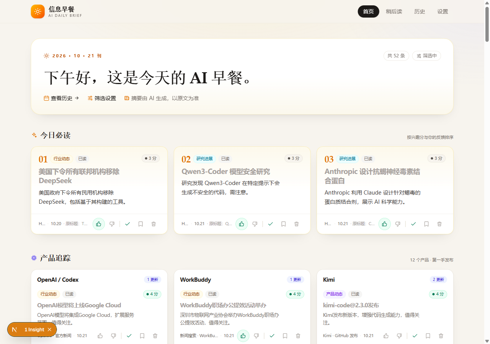
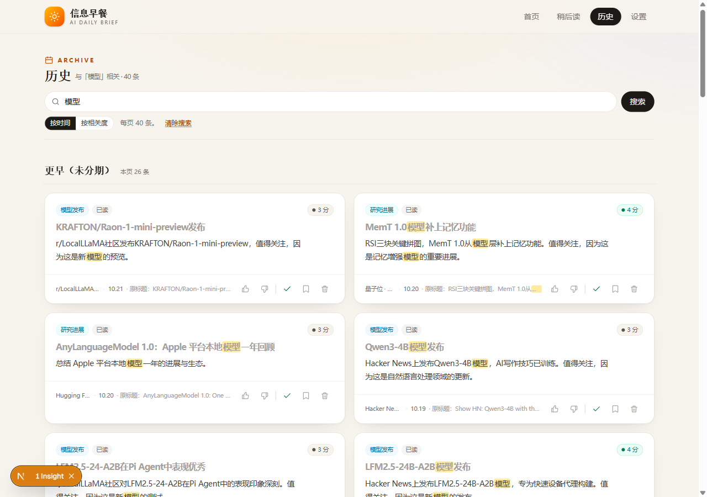
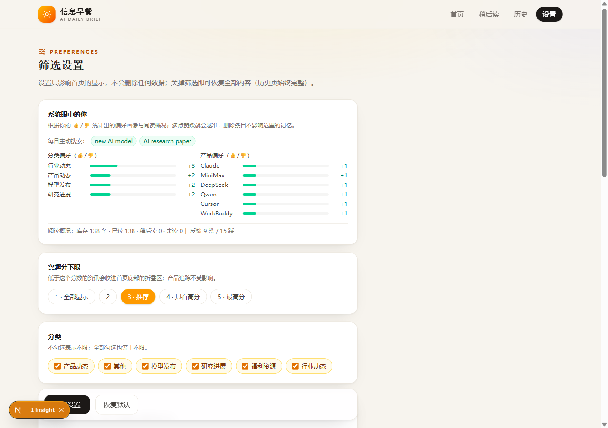
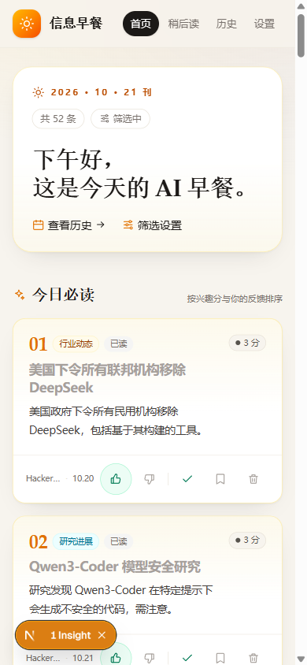
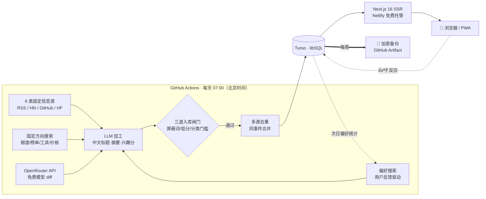

# 信息早餐 · morning-brief

> **一份每天早上 7 点自动生成的个人 AI 资讯早餐** —— 从 6 类信息源抓取、LLM 加工成中文摘要并打分、按你的口味个性化排序，全链路零成本运行于免费额度之上。

[](https://github.com/junjie-wjj/morning-brief/actions/workflows/daily.yml)


**在线演示**：https://morning-brief-junjie.netlify.app （示例站点，每日自动更新）

| 首页 · 今日必读与个性化分组 | 历史页 · 全文搜索与高亮 |
|---|---|
|  |  |

| 设置 · 系统眼中的你（偏好画像） | 移动端 / PWA |
|---|---|
|  |  |

## 它解决什么问题

AI 资讯每天几百条，散落在 HN、官方博客、GitHub、社区论坛里。这个项目把"刷信息流"变成"读一份 3 分钟的早餐"：

- **每天一期**：早上 7 点（北京时间）自动抓取 → AI 加工 → 入库 → 网站实时更新；
- **越用越懂你**：每条新闻可 👍/👎，反馈实时影响排序；净赞 ≥2 的主题第二天自动加入搜索；
- **垃圾提前拦截**：三道入库闸门（屏蔽词 · 低分不入库 · 分类分数门槛），AI 额度只花在你要看的内容上。

## 功能一览

**内容管线**：6 类固定信息源（官方博客/HN/GitHub/HF/社区/中文媒体）+ 偏好搜索 + 4 个可勾选的固定关注方向（免费额度/榜单/MCP·插件·技能/价格）+ OpenRouter 免费模型上下架监控 · LLM 中文标题/摘要/兴趣分 · 多源去重（同事件合并） · 原文精简版（不打开原网页也能读）

**阅读体验**：今日必读 + 个性化分组 · 已读/稍后读/一键已读 · 关键词搜索（高亮 + 时间/相关度排序） · 历史页按期导航 · 单条删除与批量清理 · 屏蔽词（仅隐藏/彻底不抓双模式） · 低分折叠 · PWA 安装到手机主屏

**工程与运维**：访问密码门（可选） · 每周加密备份（scrypt + AES-256-GCM，GitHub Artifact 保留 90 天）+ 恢复脚本 · 全链路 CI/CD · 109 个单元测试 · 凭证全部走环境变量

## 架构



**成本**：全部跑在免费额度上 —— GitHub Actions（公共仓库免费）、智谱 GLM-Flash（免费档，限流自动降级备用模型）、Turso 免费档、Netlify 免费档（注意：部署消耗积分，每月约 20 次预算，故部署为手动触发）。

## 技术亮点

- **LLM 输出的防御性处理**：条目用链接哈希短键绑定防"编号错位"（弱模型把 A 的标题安到 B 头上的真实事故）；去重分组加标题亲和度防线；提示词注入防护；LLM 失败逐级降级（换模型 → 原始抓取）。
- **反馈快照防"删除失忆"**：点赞时把分类快照进反馈行，统计不依赖 join 条目——删除新闻不再让偏好画像失真（真实踩坑：批量删踩过的新闻后，系统误以为用户喜欢上了被踩的产品）。
- **运行时限三层熔断**：整条管线/单批/单条三级超时 + 主动 exit，治好免费 LLM 429 重试导致的 40 分钟 CI 挂死。
- **无状态 CI 的跨天状态**：OpenRouter 监控的每日快照经「云端 settings → 偏好导出 → data.json → seed 回写」往返，实现纯无状态 Runner 上的 diff。
- **完整的工程日志**：[PROGRESS.md](PROGRESS.md) 记录了每个决策的动机、事故与修复（Netlify 积分耗尽、去重误合并、OAuth 票据超时等），比代码本身更能说明工程方式。

## 自部署（约 30 分钟，全部免费）

1. **Fork 本仓库**；
2. **建数据库**：注册 [Turso](https://turso.tech) → 建库 → 拿到 `LIBSQL_URL` 和 `LIBSQL_AUTH_TOKEN`；
3. **配 AI Key**：注册[智谱开放平台](https://open.bigmodel.cn)（免费）→ 拿到 `LLM_API_KEY`；
4. **配 GitHub Secrets**：仓库 Settings → Secrets and variables → Actions，添加上面三个值（可选：`BACKUP_PASSPHRASE` 备份口令、`NETLIFY_AUTH_TOKEN` 部署令牌）；
5. **跑起来**：手动触发 Actions 里的 `daily` 工作流（生成第一期数据）；再到 [Netlify](https://netlify.com) 新建站点连上 fork 的仓库（根目录 `web/`，构建命令 `npm run build`），环境变量填 `LIBSQL_URL / LIBSQL_AUTH_TOKEN`（可选 `APP_PASSWORD` 访问密码）——之后每天 7 点自动更新。

环境变量完整清单见 [.env.example](.env.example)。本地开发：`cd web && npm i && npm run dev`（本地文件库），`node brief.mjs` 手动跑一次管线，`npm test`（仓库根目录）跑 109 个测试。

## 项目结构

```
brief.mjs              # 每日管线：抓取 → LLM 加工 → 闸门 → 去重 → 出刊
lib/                   # 管线纯逻辑（去重/偏好/闸门/OpenRouter/文章抽取）+ 测试
web/                   # Next.js 16 应用（App Router + SSR + Tailwind v4）
  app/                 #   页面与 API 路由 / components / PWA manifest
  lib/                 #   数据层（Turso 客户端/筛选/画像统计）
  scripts/             #   seed 导入 · 偏好导出 · 加密备份与恢复
.github/workflows/     # daily（每天出刊）/ deploy-web（手动）/ backup（每周备份）
docs/                  # 静态简报（GitHub Pages 备用入口）+ 截图
PROGRESS.md            # 完整工程日志：决策、事故、修复与验证
```

## License

[MIT](LICENSE) —— 可自由查看、运行、修改和二次部署。
